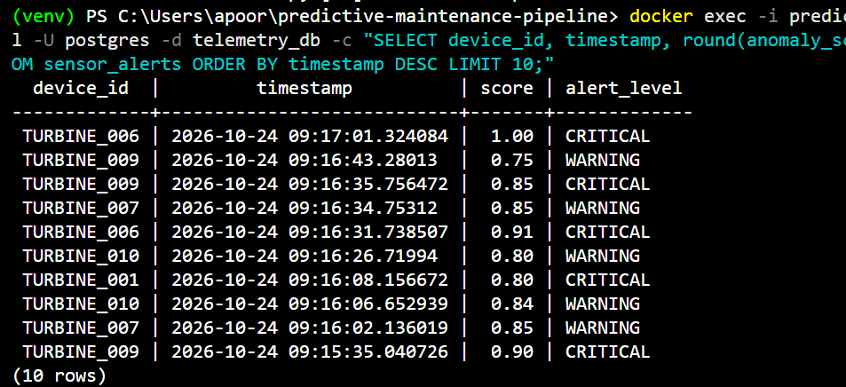
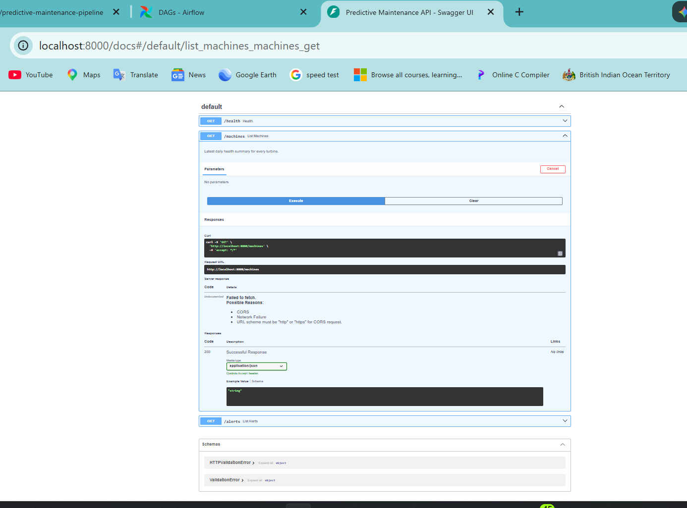
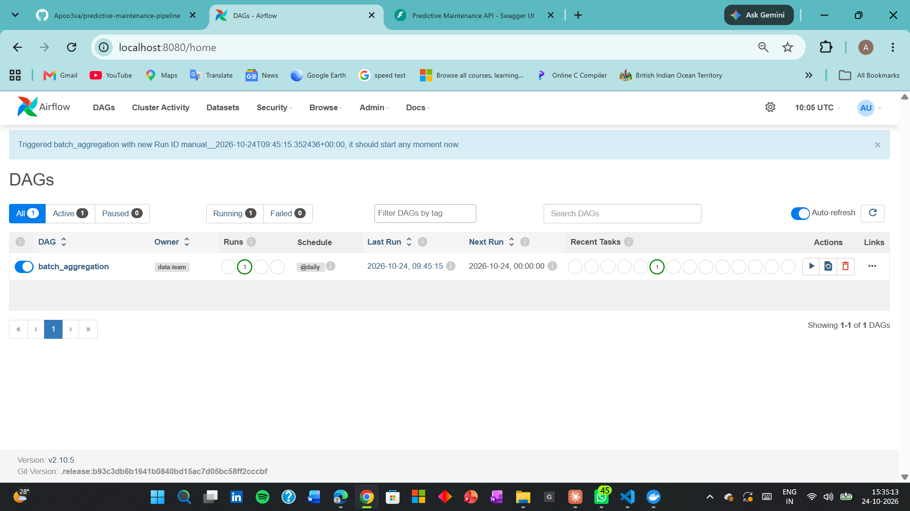
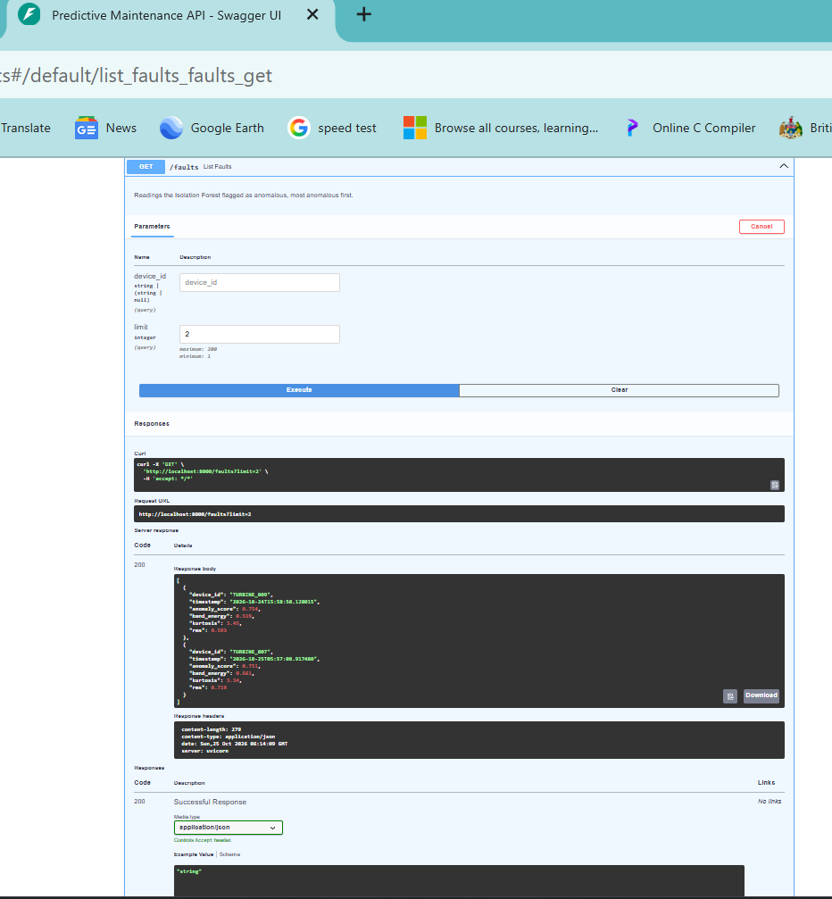

# Real-Time IoT Telemetry & Predictive Anomaly Pipeline

An end-to-end IoT data platform for rotating machinery. A simulated edge node models an accelerometer, extracts vibration features with DSP, and streams them through Kafka and Spark into PostgreSQL. An Isolation Forest scores the features for faults, Airflow builds daily health KPIs, and a FastAPI service exposes the results.

> **Note:** all sensor data is **simulated**. No hardware is used. The signal model is physics-inspired, but results demonstrate the pipeline, not real-world accuracy.

## Architecture

```
Simulated edge node (2 kHz accelerometer model, 12-bit ADC, DSP features)
        |
        v
   Apache Kafka  (topics: sensor_telemetry, sensor_features)
        |
        v
Spark Structured Streaming
  - noise filter (range checks)
  - 5-minute sliding-window rolling features
  - threshold alerts and fault flags
        |
        v
   PostgreSQL  <---------- Apache Airflow (daily KPI rollup)
        ^
        |
 Isolation Forest (scikit-learn) scores vibration features
        |
  FastAPI service (Docker)  --->  /machines  /alerts  /faults  /health
```

## Tech stack

| Layer | Tool |
|---|---|
| Signal simulation and DSP | Python, NumPy (FFT, RMS, kurtosis, crest factor) |
| Streaming ingestion | Apache Kafka + Zookeeper |
| Stream processing | PySpark Structured Streaming |
| Storage | PostgreSQL 15 (B-Tree and BRIN indexes) |
| Orchestration | Apache Airflow 2.10 |
| Machine learning | scikit-learn Isolation Forest |
| API | FastAPI + Uvicorn |
| Infrastructure | Docker Compose |

## How it works

### 1. Threshold-based telemetry pipeline
1. `producer/sensor_producer.py` publishes temperature, vibration, pressure and rpm readings for 10 turbines to the `sensor_telemetry` topic. About 5% are injected faults.
2. `spark/streaming_pipeline.py` drops physically impossible readings (range-check noise filter), flags anomalies (temperature > 85 or vibration > 4), assigns `WARNING` or `CRITICAL`, and writes to `raw_telemetry` and `sensor_alerts`. It also computes 5-minute sliding-window rolling averages and standard deviations per turbine into `device_rolling_features`.
3. `airflow/dags/batch_aggregation_dag.py` runs daily and builds one health summary per turbine per day in `device_daily_kpis`. It is idempotent: re-runs update rows instead of duplicating them.

### 2. Signal processing and ML pipeline
1. `producer/sensor_signal.py` models a rotating machine: shaft-frequency vibration, bearing-fault impulses exciting a 500 Hz resonance, Gaussian sensor noise, 2 kHz sampling (Nyquist 1 kHz) and 12-bit ADC quantization.
2. `producer/edge_node.py` acts as the edge node. Once per reading it computes RMS, peak, crest factor, kurtosis, FFT dominant frequency (Hann window) and 300-800 Hz band energy, and publishes the compact feature message to the `sensor_features` topic.
3. `spark/features_pipeline.py` reads that topic, applies the noise filter, flags faults from the vibration signature, and writes to `vibration_features`.
4. `ml/train_model.py` trains an unsupervised Isolation Forest on the features (no labels). `ml/score_model.py` stores an anomaly score and flag for every row.
5. `api/main.py` serves everything over HTTP.

## Run it locally

Requires Docker Desktop and Python 3.11+. Commands are for Windows PowerShell.

```bash
# 1. Start infrastructure. Start Zookeeper first so Kafka registers cleanly.
docker compose up -d zookeeper postgres
docker compose up -d kafka spark api airflow

# 2. Create the Airflow metadata database (first time only)
docker exec -i predictive-maintenance-pipeline-postgres-1 psql -U postgres -c "CREATE DATABASE airflow_db;"

# 3. Python environment
python -m venv venv
venv\Scripts\activate
pip install -r requirements.txt

# 4. Start the Spark jobs (one per terminal, leave them running)
docker exec -it predictive-maintenance-pipeline-spark-1 /opt/spark/bin/spark-submit --conf spark.jars.ivy=/tmp/.ivy2 --packages org.apache.spark:spark-sql-kafka-0-10_2.13:4.1.2,org.postgresql:postgresql:42.6.0 /spark-jobs/streaming_pipeline.py

docker exec -it predictive-maintenance-pipeline-spark-1 /opt/spark/bin/spark-submit --conf spark.jars.ivy=/tmp/.ivy2 --packages org.apache.spark:spark-sql-kafka-0-10_2.13:4.1.2,org.postgresql:postgresql:42.6.0 /spark-jobs/features_pipeline.py

# 5. Generate simulated data (new terminals, run for a few minutes)
python producer/sensor_producer.py
python producer/edge_node.py

# 6. Train and apply the model (after a few hundred feature rows exist)
python ml/train_model.py
python ml/score_model.py

# 7. Airflow: get the admin password, open http://localhost:8080 (user: admin),
#    then trigger the "batch_aggregation" DAG
docker compose exec airflow cat /opt/airflow/standalone_admin_password.txt
```

The API runs in Docker on http://localhost:8000. Open http://localhost:8000/docs for interactive documentation.

To shut down cleanly, run `docker compose stop`. This lets Kafka unregister from Zookeeper, which avoids a `NodeExists` startup crash next time.

## API endpoints

| Endpoint | Description |
|---|---|
| `GET /health` | Service health check |
| `GET /machines` | Latest daily health summary for each turbine |
| `GET /alerts?device_id=&alert_level=&limit=` | Recent threshold alerts, newest first, with optional filters |
| `GET /faults?device_id=&limit=` | Readings the Isolation Forest flagged, most anomalous first |

## Database

| Table | Purpose |
|---|---|
| `raw_telemetry` | Cleaned raw readings with anomaly flag and alert level |
| `sensor_alerts` | Threshold-based alerts with a simple score |
| `device_rolling_features` | 5-minute sliding-window averages and standard deviations |
| `vibration_features` | DSP features, rule-based fault flag, Isolation Forest score |
| `device_daily_kpis` | Daily per-device health summary built by Airflow |

## Screenshots

**Alerts stored in PostgreSQL**



**FastAPI interactive docs**



**Airflow DAG run**



**Isolation Forest faults served by the API**



## Design decisions

- **Two Kafka listeners** so the host (`localhost:9092`) and containers (`kafka:29092`) can both connect.
- **Edge-style processing:** the node sends compact DSP features instead of raw 2 kHz samples, as a constrained device would.
- **Idempotent batch job** using `ON CONFLICT DO UPDATE`, so Airflow retries are safe.
- **B-Tree on `(device_id, timestamp)` and BRIN on `timestamp`** for the append-only telemetry table.
- **Range-check noise filter** in Spark drops impossible readings before features are computed.
- **Watermarked windows** so rolling features are written once, after each window closes.
- **Parameterised SQL** in the API to prevent SQL injection.
- **Unsupervised model:** the Isolation Forest needs no fault labels, only the assumption that faults are rare.

## Results and limitations

- On a 459-reading simulated set, the Isolation Forest flagged all 24 rule-flagged faults plus 4 borderline readings. The faults and features come from the same simulator and the model was scored on its training data, so this shows the pipeline works, not real-world accuracy.
- Anomaly detection in the first pipeline is threshold-based by design.
- The sensor producers and Spark jobs are started manually.
- Model scoring is a manual script, not yet scheduled in Airflow.
- Database credentials are hardcoded for local development.
- There are no automated tests yet.

## Possible next steps

- Schedule model retraining and scoring as an Airflow DAG
- Replay a public bearing dataset (for example the Case Western Reserve University set) through the pipeline
- Add a dashboard on top of the API
- Add tests, CI, and environment-based configuration